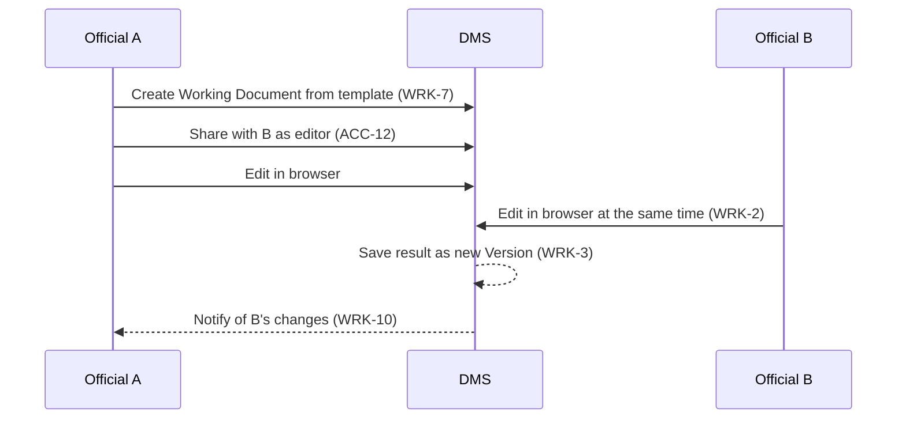

# Description

A Working Document is a Document still being created or revised, editable by several people at once without a mandatory process. Collaborative Editing provides what that needs: creation in common office formats (WRK-1), simultaneous editing in a browser (WRK-2), a new Version for every saved result (WRK-3), previews (WRK-4), synchronisation with desktop and mobile clients (WRK-5) and editing by guests (WRK-6).

Co-editing may be built in or provided by a connected office editor. The DMS remains responsible for storage, Versions and permissions.

Federated sharing through Open Cloud Mesh (WRK-12) lets an organisation share with partners at other institutions while keeping the master copy. A Working Document can also start as a copy of a record (WRK-13), which gives officials an editable draft outside the record's process.

# Workflows

## A briefing note is drafted by three officials

