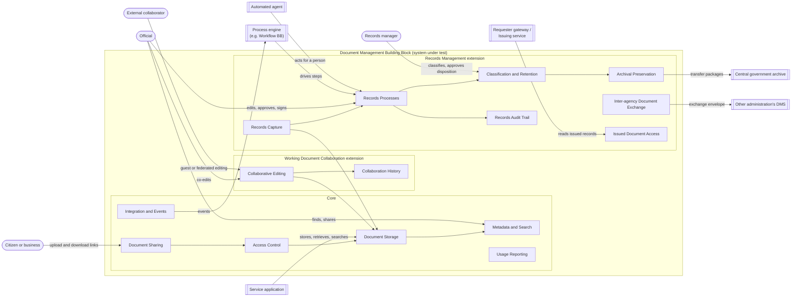

# Description

## System under test

The system under test is a software component that stores the documents and files of government services and administrations, keeps their metadata and versions, controls who may reach them and, when the solution claims the extensions, supports collaborative editing of Working Documents and the management of Records Documents.

Its boundary includes everything a solution relies on to provide its functionalities: its API, its web interface, its synchronisation clients and, where co-editing is provided by a connected office editor, that editor as configured with the solution. It excludes the service applications that use it, process engines that orchestrate work across systems, signature creation and validation services, identity providers, and the central government archive that receives transfer packages.

The Building Block is assessed as a black box, through its Service API, its events, the files it produces and its user interface. Some characteristics cannot be observed from outside: whether content leaves the deployment for analysis, whether the activity trail is protected against alteration, and how long activity records are kept. The requirements that cover them are verified by audit.

## Functionalities

| Functionality | Realises | Conformance | Description | Requirements |
|---|---|---|---|---|
| Document Storage | Document Capture | Core | Officials, citizens and services hand documents and files to the administration and get them back, under an identifier that never changes, with every earlier version kept and nothing lost when a person leaves or the product is replaced. | `requirements/document-storage.md` |
| Metadata and Search | Document Capture, Document Findability, Access Protection | Core | Documents carry the context a service needs, such as the case they belong to or the person they concern, and officials and services find them again by that context, by their content or by the person concerned. | `requirements/metadata-and-search.md` |
| Access Control | Access Protection | Core | Each document is reachable only by the people and services entitled to it, and the same rules hold whichever way it is reached. | `requirements/access-control.md` |
| Document Sharing | Document Exchange, Access Protection | Core | Documents reach colleagues, citizens and partners in a controlled way: shared with named people, handed out or collected through time-limited links, and withdrawn when no longer needed. | `requirements/document-sharing.md` |
| Integration and Events | Service Integration | Core | Services, process engines and other Building Blocks act on documents through agreed interfaces and learn when documents change, without polling. | `requirements/integration-and-events.md` |
| Usage Reporting | Accountability | Core | Administrators and auditors see how the document stock develops and where access was refused, so that capacity, housekeeping and security issues are noticed early. | `requirements/usage-reporting.md` |
| Collaborative Editing | Collaborative Authoring, Document Exchange | Working Document Collaboration extension | Officials and invited partners draft and revise Working Documents together, at the same time and from any device, without exchanging copies by email. | `requirements/collaborative-editing.md` |
| Collaboration History | Accountability, Collaborative Authoring | Working Document Collaboration extension | Collaborators see who created, changed, moved, shared or deleted a Working Document, and when. | `requirements/collaboration-history.md` |
| Records Capture | Document Capture, Controlled Processing, Long-term Preservation | Records Management extension | Documents that serve as evidence enter the records regime with a document type, a state and a fixed content once finalized, whether they start as an upload, a draft or a set of metadata fields. | `requirements/records-capture.md` |
| Records Processes | Controlled Processing | Records Management extension | A Records Document in process is edited, reviewed, approved and signed only by the people assigned to each step of a predefined process, in series or in parallel, and is finalized when the last step is completed. | `requirements/records-processes.md` |
| Classification and Retention | Retention and Disposition, Access Protection | Records Management extension | Each record belongs to a class of the organisation's classification scheme, which sets who may see it and how long it is kept, and records are destroyed or transferred only after an authorised decision. | `requirements/classification-and-retention.md` |
| Archival Preservation | Long-term Preservation | Records Management extension | Records stay authentic and readable for decades, move to an organisational archive when their active use ends, and are handed over to the central archive in a standard package with their context. | `requirements/archival-preservation.md` |
| Records Audit Trail | Accountability | Records Management extension | Every action on a record, including views, approvals and signatures, can be traced to a person, or to an automated agent acting for one, and a time, in a trail that cannot be altered unnoticed. | `requirements/records-audit-trail.md` |
| Inter-agency Document Exchange | Document Exchange | Records Management extension | Administrations send records to each other in an agreed envelope through the Information Mediator, and register what they receive, instead of exchanging them by email. | `requirements/document-exchange.md` |
| Issued Document Access | Document Exchange | Records Management extension | A record issued to a person, such as a permit or a certificate, becomes the authoritative source behind that person's document wallet: requesters fetch it from its source with the person's consent, and can check that it is still valid. | `requirements/issued-documents.md` |

Capabilities are divided among the functionalities as follows. **Document Capture** rests on Document Storage and Metadata and Search for every solution, and on Records Capture when a document becomes evidence. **Document Findability** is Metadata and Search. **Access Protection** is Access Control, with Document Sharing deciding how items leave their normal permissions, and Classification and Retention adding rules per record class. **Document Exchange** starts with Document Sharing in the core; the collaboration extension adds guest editing and federated sharing, and the records extension adds exchange between administrations and access to issued documents for document wallets. **Accountability** is Usage Reporting in the core, Collaboration History for Working Documents and the Records Audit Trail for Records Documents. **Service Integration** is Integration and Events. The other four capabilities are provided only through the extensions.

Functionalities a reader might expect but that are placed elsewhere: orchestrating processes across systems (Workflow Building Block), creating and validating electronic signatures (e-Signature Building Block), generating documents from data (the service application), publishing documents on public websites (a Content Management System Building Block), holding credentials for citizens (Wallet Building Block), and operating the central government archive (the adopting government). See the scope for their owners.

### Core and extensions

The core is what makes a product a document management system: it keeps documents and files under stable identifiers with their versions and metadata, finds them again, controls who may reach them, and survives staff changes and a change of product. A solution that meets only the core can serve every service application that needs to store and retrieve supporting documents, even if it offers no co-editing and no records management.

| Extension | Adds | Functionalities | Role served | Requires |
|---|---|---|---|---|
| Working Document Collaboration | Editing Working Documents at the same time in a browser and on synchronised devices, with guests and partner organisations, and seeing who changed what | Collaborative Editing, Collaboration History | | |
| Records Management | Managing Records Documents from declaration through predefined processes, finalization, classification and retention to disposition or archival transfer, with a complete audit trail | Records Capture, Records Processes, Classification and Retention, Archival Preservation, Records Audit Trail, Inter-agency Document Exchange, Issued Document Access | | |

Both are extensions because some conformant products legitimately lack them. A product built for synchronising and sharing files is a useful document management system without records processes and retention schedules, and a records system is useful without simultaneous editing in a browser. Neither extension serves a role of a Domain Reference Architecture, because none exists for the domain yet.

Expected combinations: a sync-and-share product claims the core and Working Document Collaboration; a records management product claims the core and Records Management; a product that covers the whole lifecycle claims both.

*Figure 3: functionality map, with the core and two extensions.*

## Actors

| Actor | Kind | Boundary | Reaches the Building Block through | Specified where |
|---|---|---|---|---|
| Official | Person | Outside | Metadata and Search, Document Sharing; Collaborative Editing (Working Document Collaboration extension); Records Processes (Records Management extension) | Not specified: a person is not assessed. The user interface is specified here |
| Citizen or business | Person | Outside | Document Sharing (links), usually through a service application | Not specified |
| External collaborator | Person | Outside | Document Sharing; Collaborative Editing (Working Document Collaboration extension) | Not specified |
| Records manager | Person | Outside | Classification and Retention, Archival Preservation (Records Management extension) | Not specified |
| Service application | System | Outside | Document Storage, Metadata and Search, Integration and Events | The government's Digital Service System |
| Process engine | System | Outside | Integration and Events; Records Processes (Records Management extension) | `govstack:spec:bb:workflow` |
| Automated agent | System | Outside | Records Processes, Records Audit Trail (Records Management extension) | Not specified: acts with the permissions of the person it acts for |
| Other administration's document management system | System | Outside | Inter-agency Document Exchange (Records Management extension) | The exchange envelope specification (open question) |
| Central government archive | System | Outside | Archival Preservation (Records Management extension) | The adopting government's archive authority |
| Issuing service and requester gateway | System | Outside | Issued Document Access (Records Management extension) | `govstack:ra:credentials` |

## Interfaces

| Interface | Counterpart | Direction | Functionality | Type | Contract defined in |
|---|---|---|---|---|---|
| Document Management API | Service application, process engine, automated agent | Inbound | All functionalities | Service API | This specification, `resources/api` (to be written) |
| WebDAV and CMIS access | Clients and service applications | Inbound | Integration and Events | Service API | IETF RFC 4918; OASIS CMIS 1.1 |
| Document events | Process engine, subscribers | Outbound | Integration and Events; Records Processes; Issued Document Access | Event | This specification |
| Web interface and synchronisation clients | Official, external collaborator | Both | Collaborative Editing, Collaboration History, Records Processes | User interface | This specification |
| Exports and reports | Administrators, other systems | Outbound | Document Storage, Metadata and Search, Usage Reporting, Records Audit Trail, Issued Document Access | File | This specification |
| Records renditions and signature containers | Archive, e-Signature BB | Both | Records Capture | File | ISO 19005 (PDF/A); ETSI EN 319 162-1 (ASiC) |
| Archival transfer packages | Central government archive | Outbound | Archival Preservation | File | E-ARK SIP specification |
| Federated sharing | Partner organisation's system | Both | Collaborative Editing | Protocol | Open Cloud Mesh (OCM) |
| Document exchange envelope | Other administration's document management system, through the Information Mediator | Outbound send, inbound receipt | Inter-agency Document Exchange | Consumed API | `govstack:spec:bb:information-mediator`; envelope specification to be agreed |

Logging, monitoring, authentication and deployment interfaces are inherited from the cross-functional requirements and are not listed.
