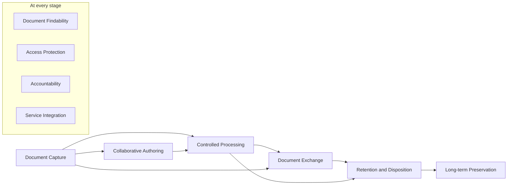
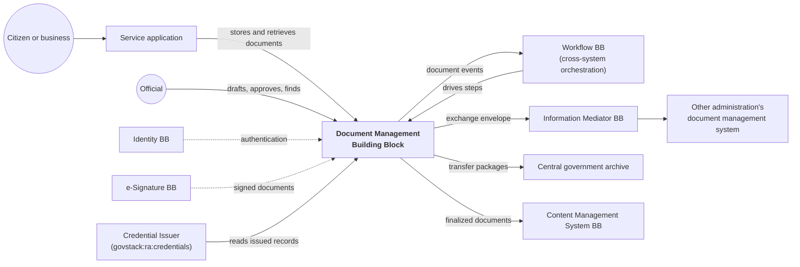

# Purpose

## Value

The Document Management Building Block exists so that government services and administrations can keep the documents they receive and produce under control through their whole life, from a citizen's upload to the archive.

Today many services depend on citizens uploading supporting documents, such as certificates, forms, plans and other evidence, and on officials producing documents in return, such as permits, decisions and reports. These functions are often built into each service application, or handed to external services, using the file structure of a web application. They rarely handle what happens next: documents are revised and approved by officials, kept for a legal period, handed to other administrations, and finally destroyed or archived. Documents end up reachable only by the administrators of each application, and exchanged between agencies by email.

The Document Management Building Block provides capabilities along the whole document lifecycle:

| Lifecycle stage | Capability | Provided by |
|---|---|---|
| Capture | **Document Capture**: documents come under the administration's custody with a stable identity, a version history and their context | Every conformant solution; Records Management adds records capture |
| Drafting | **Collaborative Authoring**: officials and partners draft and revise documents together | Solutions that claim the Working Document Collaboration extension |
| Processing | **Controlled Processing**: evidence is edited, reviewed, approved and signed only along a predefined process, and fixed when it ends | Solutions that claim the Records Management extension |
| Exchange | **Document Exchange**: documents reach citizens, partners, other administrations and document wallets under control | Every conformant solution (sharing); both extensions add to it |
| Retention | **Retention and Disposition**: records are kept as long as the law requires, then destroyed or transferred after an authorised decision | Solutions that claim the Records Management extension |
| Preservation | **Long-term Preservation**: records stay authentic and readable for decades and reach the archive with their context | Solutions that claim the Records Management extension |
| Every stage | **Document Findability**, **Access Protection**, **Accountability** and **Service Integration** | Every conformant solution; both extensions add to Accountability |

*Figure 1: capabilities along the document lifecycle. Collaborative Authoring is provided only by solutions that claim the Working Document Collaboration extension; Controlled Processing, Retention and Disposition, and Long-term Preservation only by solutions that claim the Records Management extension.*

A common specification matters here for three reasons. The first is **replaceability**: dozens of service applications store their documents in one document management system, and without an agreed interface a government that changes supplier must rewrite all of them, so in practice it never changes supplier. The second is **interoperability**: administrations hand documents to each other, process engines start and steer work on documents, and document wallets refer to issued documents at their source; each of these integrations is built once when every conformant solution behaves alike at its interfaces. The third is **assurance**: a procurement can require the core and name the extensions it needs, and a buyer can compare products against the same statement of what they must do.

## Place in larger systems

The Document Management Building Block operates within the GovStack Architecture, and every conformant solution meets the GovStack cross-functional requirements.

No Domain Reference Architecture for document and records management exists yet. The Working Group describes the domain context here in the Building Block's own terms, and reports the gap to the Architecture Working Group. Two kinds of process logic surround the Building Block, and both are needed: **intra-system records processes**, which move a document through edit, review, approval and signature steps inside one system and are specified here in the Records Management extension; and **cross-system orchestration**, which moves work between systems and belongs to the Workflow Building Block or another process engine.

In the Credentials Reference Architecture (`govstack:ra:credentials`), the Building Block performs no role of its own. It is the authoritative source behind a **Credential Issuer** for issued documents, such as permits and certificates, which a citizen's wallet refers to. The obligations it has in that context are in *Issued Document Access*, part of the Records Management extension.

The Building Block commonly works with:

- the **Workflow** Building Block, which starts and steers processes across systems, reacts to document events and drives records process steps through the API;
- the **Identity** Building Block, which authenticates the people and services that reach documents;
- the **e-Signature** Building Block, which creates and validates the signatures on documents the Building Block stores;
- the **Information Mediator** Building Block, which carries documents exchanged between administrations;
- the **Messaging** Building Block, which notifies citizens, for example that a document is ready;
- a **Content Management System** Building Block, which publishes finalized documents on public websites;
- the **Digital Registries** Building Block, which holds structured data that documents refer to;
- the **Consent** Building Block, which records a person's consent where sharing a document requires it.

It is a feature Building Block that most service applications handling supporting documents depend on.

*Figure 2: the Document Management Building Block in a government's Digital Service System. Illustrative.*
