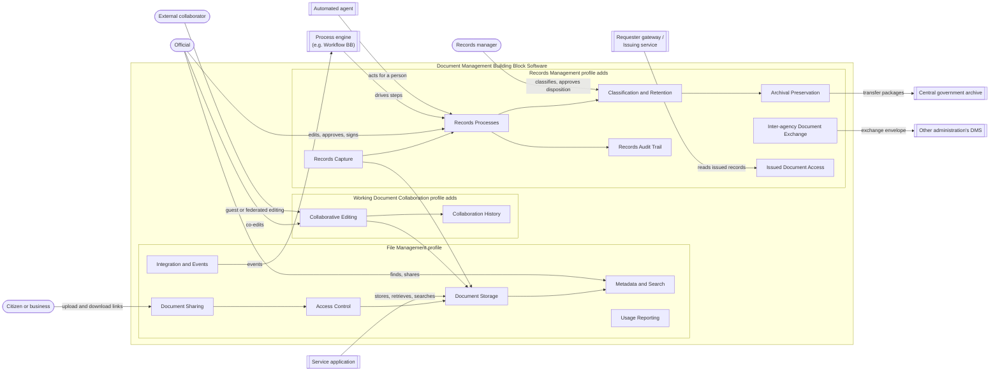

# Technical overview

## Market assessment

The Working Group looked at four types of software that governments use, or could use, to manage the documents of their services and administrations.

| Software type | What it does |
|---|---|---|
| File synchronisation and sharing platforms | Storing files with versions, synchronising them to desktop and mobile devices, sharing with named people and through links, simultaneous editing through a connected office editor, federated sharing between institutions |
| Enterprise content and records management systems | Document types with typed metadata, documents made of metadata alone, workflows with serial and parallel steps, classification and retention, legal holds, detailed audit trails, archival transfer, exchange of documents between administrations |
| Single-purpose public service applications | Collecting and checking the documents citizens submit for one procedure, deleting them when no longer needed, and telling the account holder apart from the persons the documents concern |
| Office editors connected to a document store | Simultaneous editing of office documents in the browser |

The functionalities follow from this comparison:

- **What every document store has in common** became the File Management profile: storing files under stable identifiers with versions, metadata and search, permissions, sharing, integration and reporting. Software products of the first two types can meet it.
- **What distinguishes file synchronisation and sharing platforms** became the Working Document Collaboration profile: collaborative editing and its history.
- **What distinguishes records management systems** became the Records Management profile: records capture, records processes, classification and retention, archival preservation, the records audit trail, exchange between administrations and access to issued documents. The profile also takes in obligations from records law and standards, such as ISO 15489-1 and the archiving model discussed in the Working Group.
- **Single-purpose public service applications** contributed requirements rather than a profile. They showed that documents must be linked to the persons they concern separately from their uploader (MET-11), and that data minimisation can call for automatic deletion (STO-16).

## Functionalities

| Functionality | Realises | Conformance profiles | Description | Requirements |
|---|---|---|---|---|
| Document Storage | Document Capture | File Management, Working Document Collaboration, Records Management | Officials, citizens and services hand documents and files to the administration and get them back, under an identifier that never changes, with every earlier version kept and nothing lost when a person leaves or the software product is replaced. | `requirements/document-storage.md` |
| Metadata and Search | Document Capture, Document Findability, Access Protection | File Management, Working Document Collaboration, Records Management | Documents carry the context a service needs, such as the case they belong to or the person they concern, and officials and services find them again by that context, by their content or by the person concerned. | `requirements/metadata-and-search.md` |
| Access Control | Access Protection | File Management, Working Document Collaboration, Records Management | Each document is reachable only by the people and services entitled to it, and the same rules hold whichever way it is reached. | `requirements/access-control.md` |
| Document Sharing | Document Exchange, Access Protection | File Management, Working Document Collaboration, Records Management | Documents reach colleagues, citizens and partners in a controlled way: shared with named people, handed out or collected through time-limited links, and withdrawn when no longer needed. | `requirements/document-sharing.md` |
| Integration and Events | Service Integration | File Management, Working Document Collaboration, Records Management | Services, process engines and other Building Blocks act on documents through agreed interfaces and learn when documents change, without polling. | `requirements/integration-and-events.md` |
| Usage Reporting | Accountability | File Management, Working Document Collaboration, Records Management | Administrators and auditors see how the document stock develops and where access was refused, so that capacity, housekeeping and security issues are noticed early. | `requirements/usage-reporting.md` |
| Collaborative Editing | Collaborative Authoring, Document Exchange | Working Document Collaboration | Officials and invited partners draft and revise Working Documents together, at the same time and from any device, without exchanging copies by email. | `requirements/collaborative-editing.md` |
| Collaboration History | Accountability, Collaborative Authoring | Working Document Collaboration | Collaborators see who created, changed, moved, shared or deleted a Working Document, and when. | `requirements/collaboration-history.md` |
| Records Capture | Document Capture, Controlled Processing, Long-term Preservation | Records Management | Documents that serve as evidence enter the records regime with a document type, a state and a fixed content once finalized, whether they start as an upload, a draft or a set of metadata fields. | `requirements/records-capture.md` |
| Records Processes | Controlled Processing | Records Management | A Records Document in process is edited, reviewed, approved and signed only by the people assigned to each step of a predefined process, in series or in parallel, and is finalized when the last step is completed. | `requirements/records-processes.md` |
| Classification and Retention | Retention and Disposition, Access Protection | Records Management | Each record belongs to a class of the organisation's classification scheme, which sets who may see it and how long it is kept, and records are destroyed or transferred only after an authorised decision. | `requirements/classification-and-retention.md` |
| Archival Preservation | Long-term Preservation | Records Management | Records stay authentic and readable for decades, move to an organisational archive when their active use ends, and are handed over to the central archive in a standard package with their context. | `requirements/archival-preservation.md` |
| Records Audit Trail | Accountability | Records Management | Every action on a record, including views, approvals and signatures, can be traced to a person, or to an automated agent acting for one, and a time, in a trail that cannot be altered unnoticed. | `requirements/records-audit-trail.md` |
| Inter-agency Document Exchange | Document Exchange | Records Management | Administrations send records to each other in an agreed envelope through the Information Mediator, and register what they receive, instead of exchanging them by email. | `requirements/document-exchange.md` |
| Issued Document Access | Document Exchange | Records Management | A record issued to a person, such as a permit or a certificate, becomes the authoritative source behind that person's document wallet: requesters fetch it from its source with the person's consent, and can check that it is still valid. | `requirements/issued-documents.md` |

Capabilities are divided among the functionalities as follows. **Document Capture** rests on Document Storage and Metadata and Search in every profile, and on Records Capture when a document becomes evidence. **Document Findability** is Metadata and Search. **Access Protection** is Access Control, with Document Sharing deciding how items leave their normal permissions, and Classification and Retention adding rules per record class. **Document Exchange** starts with Document Sharing in File Management; Working Document Collaboration adds guest editing and federated sharing, and Records Management adds exchange between administrations and access to issued documents for document wallets. **Accountability** is Usage Reporting in File Management, Collaboration History for Working Documents and the Records Audit Trail for Records Documents. **Service Integration** is Integration and Events. The other four capabilities are provided only by the Working Document Collaboration and Records Management profiles.

Functionalities a reader might expect but that are placed elsewhere: orchestrating processes across systems (Workflow Building Block), creating and validating electronic signatures (e-Signature Building Block), generating documents from data (the service application), publishing documents on public websites (a Content Management System Building Block), holding credentials for citizens (Wallet Building Block), and operating the central government archive (the adopting government). See the scope for their owners.

### Conformance profiles

The Building Block defines three conformance profiles. A Building Block Software conforms to a profile when it meets every REQUIRED requirement of every functionality in that profile.

| Profile | Includes | Adds | Suited to |
|---|---|---|---|
| File Management | – | Document Storage, Metadata and Search, Access Control, Document Sharing, Integration and Events, Usage Reporting | Software that keeps the supporting documents and produced files of government services, finds them again and protects them |
| Working Document Collaboration | File Management | Collaborative Editing, Collaboration History | Software where officials and partners draft documents together |
| Records Management | File Management | Records Capture, Records Processes, Classification and Retention, Archival Preservation, Records Audit Trail, Inter-agency Document Exchange, Issued Document Access | Software that manages documents as evidence, from guided editing to retention and archiving |

A Building Block Software can claim Working Document Collaboration and Records Management together. Each profile is described in the folder `conformance-profiles`, with its purpose, example use cases, functionalities, the actors relevant for testing and its interfaces.

*Figure 3: functionality map by conformance profile.*
