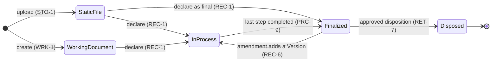

# Description

A Records Document is a Document created, received or maintained as evidence of an activity, decision or transaction, in pursuit of legal obligations or in the transaction of business (adapted from ISO 15489-1:2016, 3.14). Purpose, not finality, makes a record: a building permit decision is a record from its first draft.

Records Capture brings items into that regime. A Static File or a Working Document is declared a record (REC-1), either in process, when it still needs editing along a records process, or directly finalized, as with citizen evidence received as submitted. A record may also consist of metadata fields alone (REC-2). Each record has a document type with typed fields and a default records process (REC-3).

Once finalized, a Version never changes (REC-5). Later changes add new Versions through an amendment process (REC-6), which is how ISO 15489's integrity principle allows controlled additions.

# Workflows

# Data structures

| Field | Type | Notes |
|---|---|---|
| document_type | string | From the configured document types (REC-3) |
| state | enum | `IN_PROCESS`, `FINALIZED` (REC-4) |
| record_class | string | Class of the classification scheme (RET-1) |
| versions | list | Each finalized Version with its SHA-256 checksum (REC-9) |
| renditions | list | Archival renditions such as PDF/A (REC-10) |
| signatures | list | Detached signatures linked to the signed File (REC-7) |
