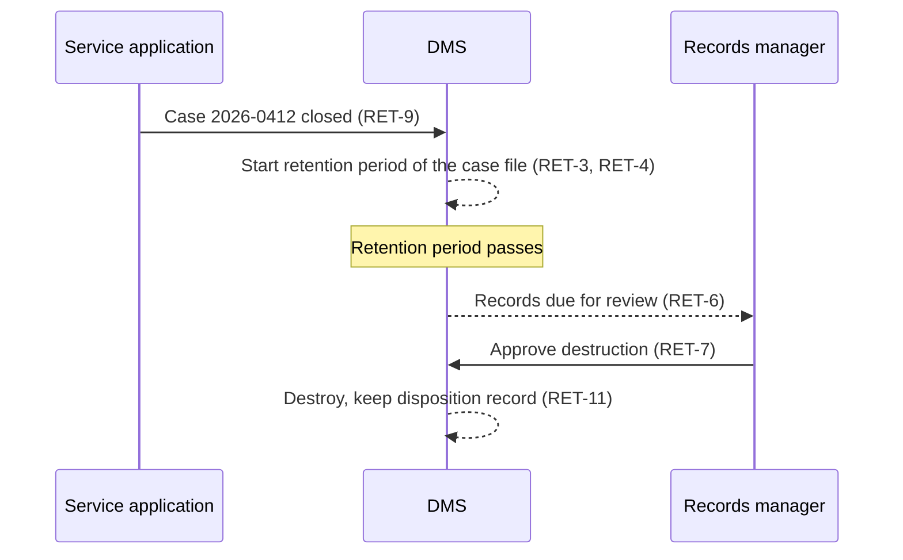

# Description

Classification ties each record to a class of the organisation's file plan (RET-1). The class carries the access rules (RET-2) and the retention schedule: the retention period, the event that starts it and the action at its end (RET-3). A records aggregation, such as a case file, groups records whose retention starts together when the aggregation closes (RET-4).

Nothing leaves the regime silently. A finalized record cannot be deleted outside an approved disposition (RET-5); records due for disposition are listed for review (RET-6); every disposition action needs an authorised approval (RET-7). A legal hold suspends disposition (RET-10), and a disposition record remains after destruction (RET-11).

Transfer to an archive, which is one possible disposition action, is described in *Archival Preservation*.

# Workflows

# Data structures

| Retention schedule field | Type | Notes |
|---|---|---|
| class_id | string | Class of the classification scheme |
| retention_period | duration | For example ten years |
| trigger_event | string | For example `case.closed`; empty when the period starts at finalization |
| disposition_action | enum | `DESTROY`, `TRANSFER`, `REVIEW` |
| access_rules | list | Applied to every record in the class (RET-2) |
