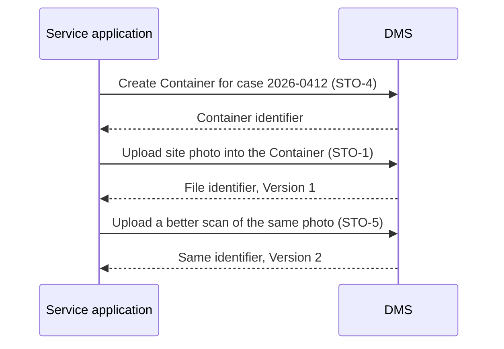

# Description

Document Storage is the part of the DMS every other functionality relies on. A service application or an official submits a File, and the DMS returns an identifier that stays valid when the File is renamed or moved. Replacing the content never overwrites it.

Files live in Containers, such as folders, team spaces or case files. A Container belongs to an organisational unit rather than to one person (STO-9), so that documents survive staff changes. The whole content of a Container can be exported with its structure in open formats (STO-10), so that documents stay usable whatever happens to the software solution.

Deletion is reversible for a configured period (STO-8). Optional safeguards add protection marks (STO-18) and a second approval before an early purge (STO-19). Records Documents follow the stricter deletion rules of *Classification and Retention*.

# Workflows

## A citizen's evidence is stored for a case

# Data structures

| Item | Fields the DMS returns at minimum |
|---|---|
| File | identifier, name, media type, size in bytes, creation time, last modification time (UTC), owner, current Version number (see *Metadata and Search*, MET-1) |
| Version | Version number, major or minor label (STO-17), creation time (UTC), author, size in bytes |
| Container | identifier, name, parent Container, owning organisational unit, managers (STO-9) |
