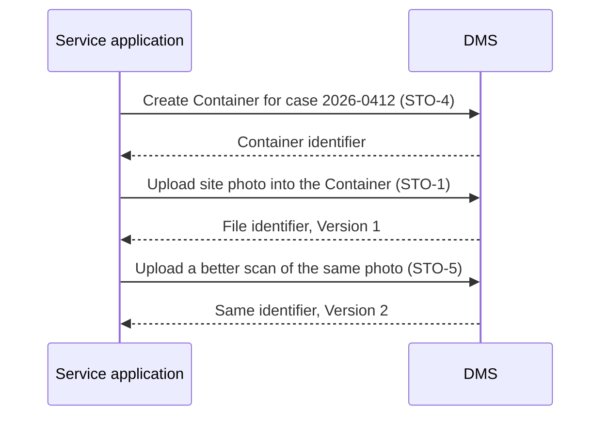

# Description

File Storage is the part of the DMS every other functionality relies on. A service application or an official submits a File, and the DMS returns an identifier that stays valid when the File is renamed, moved, given a new Version or restored. Replacing the content never overwrites it.

Files live in Containers, such as folders, team spaces or case files. A Container belongs to an organisational unit or group rather than to one person (STO-9), so that documents survive staff changes. A whole Container can be exported as a package with its Files, their Versions and their metadata (STO-10), so that documents stay usable whatever happens to the software solution.

Deletion is reversible for a configured period. Records Documents follow the stricter deletion rules of *Classification and Retention*.

# Workflows

## A citizen's evidence is stored for a case

# Data structures

The fields of a File are listed in *Metadata and Search*.

| Item | Fields the DMS returns at minimum |
|---|---|
| Version | Version number, creation time (UTC), author, size in bytes, SHA-256 digest where offered (MET-20) |
| Container | identifier, name, parent Container, owning organisational unit or group, managers (STO-9) |
