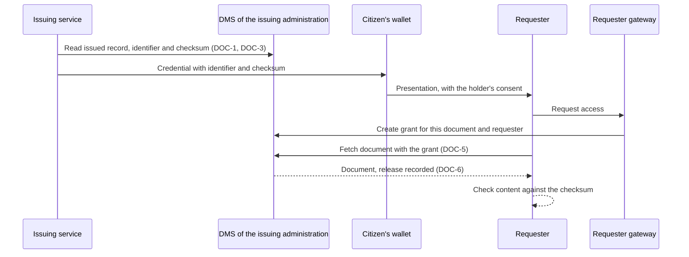

# Description

In a document wallet, the person's wallet usually holds a reference to a document, not a copy. The document stays with the administration that issued it, which is the authoritative source; a requester, such as a bank or a university, fetches it from there with the person's consent and checks it against a checksum the issuer put into a credential.

The DMS of the issuing administration is that source. It never talks to the Wallet Building Block directly: an issuing service sits between them, and a requester gateway creates the grant under which the DMS releases a document (DOC-5).

All requirements are RECOMMENDED for now. Once the Working Group agrees on the REQUIRED ones, this functionality may become an extension of its own that requires Records Management.

# Workflows

