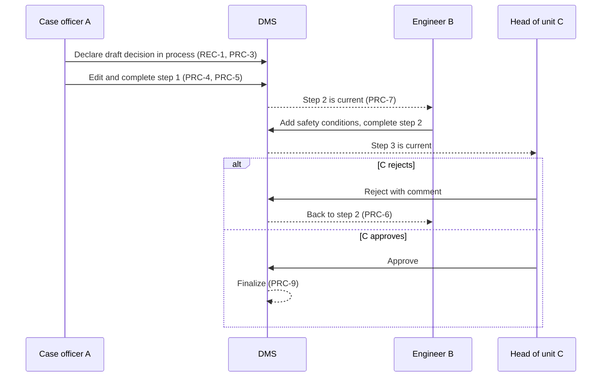

# Description

Records Processes are the intra-system workflows of the DMS: the steps a Records Document passes through between declaration and finalization. Orchestration across systems and Building Blocks stays with the Workflow Building Block or another process engine.

A process definition is a set of steps, each with an action and an assignee (PRC-1), arranged in series, in parallel or both (PRC-2). While a step is current, only its assigned editors may change the content (PRC-4). Every completed step is recorded (PRC-5), a rejection returns the record to an earlier step (PRC-6), and the record is finalized when the last step is completed (PRC-9).

# Workflows

## A building permit decision: A edits, B edits, C approves

# Data structures

| Process definition field | Type | Notes |
|---|---|---|
| process_id | string | |
| name | string | |
| steps | list of step | |
| step.id | string | |
| step.action | enum | `EDIT`, `REVIEW`, `APPROVE`, `SIGN` |
| step.assignee | object | A user, a group or a role; or the manager of the initiator (PRC-18) |
| step.after | list of step ids | Steps that must be completed first; steps with the same predecessors run in parallel (PRC-2) |
| step.on_reject | step id | Step the record returns to when rejected (PRC-6) |
| step.group_completion | enum | `ANY_MEMBER`, `ALL_MEMBERS` (PRC-13) |
